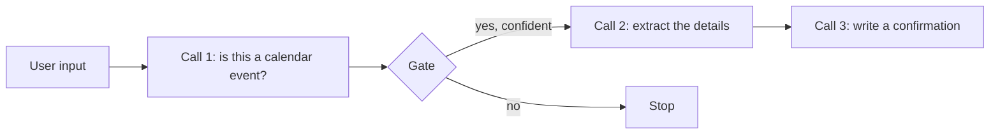
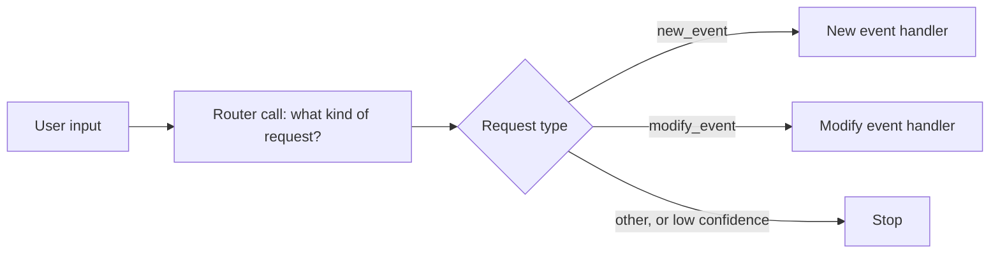
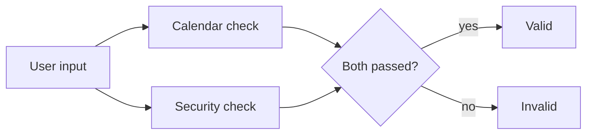

# Building Effective Agents in TypeScript

Eight small TypeScript scripts that show how LLM agents are built. The first
four cover the building blocks: a basic call, structured output, tool use and
retrieval. The other four are workflow patterns that combine those blocks.
Each script is one file that you can read from top to bottom and run with one
command.

- **No agent framework.** The code calls the model through the official
  `openai` package and validates the answers with [Zod](https://zod.dev).
- **Works without an API key.** With an OpenAI key the scripts use OpenAI.
  Without one they use a model on your own computer through
  [Ollama](https://ollama.com).
- **Written for learning TypeScript.** Every file is commented in detail, and
  the comments that start with `TS:` explain the TypeScript idea used at that
  point.

The patterns come from Anthropic's article
[Building Effective Agents](https://www.anthropic.com/engineering/building-effective-agents).

## The examples

| Command | File | What it shows |
| --- | --- | --- |
| `npm run intro:basic` | `src/1-introduction/1-basic.ts` | Send messages to the model and print its answer. |
| `npm run intro:structured` | `src/1-introduction/2-structured.ts` | Get the answer as JSON in a fixed shape, checked against a schema. |
| `npm run intro:tools` | `src/1-introduction/3-tools.ts` | Let the model ask for a function to be run (a weather lookup), then answer from the result. |
| `npm run intro:retrieval` | `src/1-introduction/4-retrieval.ts` | The same tool pattern, with a tool that reads a small knowledge base. |
| `npm run workflow:chaining` | `src/2-workflow-patterns/1-prompt-chaining.ts` | [Prompt chaining](#prompt-chaining): a sequence of calls with a check in between. |
| `npm run workflow:routing` | `src/2-workflow-patterns/2-routing.ts` | [Routing](#routing): classify a request, then send it to the matching handler. |
| `npm run workflow:parallel` | `src/2-workflow-patterns/3-parallelization.ts` | [Parallelization](#parallelization): run several calls at the same time and combine the answers. |
| `npm run workflow:orchestrator` | `src/2-workflow-patterns/4-orchestrator.ts` | [Orchestrator-workers](#orchestrator-workers): one call plans the work, others do it, a last one reviews it. |

You can also run any file directly: `npx tsx src/1-introduction/1-basic.ts`.

`intro:tools` calls the free [Open-Meteo](https://open-meteo.com) weather API,
so it needs an internet connection even when the model runs on your computer.

## Setup

You need [Node.js](https://nodejs.org) 22 or newer.

Clone this repository, open a terminal in its folder and install the packages:

```bash
npm install
```

Then decide where the model runs. The scripts check each time they start:

| If | the scripts use |
| --- | --- |
| `OPENAI_API_KEY` is set | OpenAI, with the models `gpt-4o` and `gpt-4o-mini` |
| there is no key | Ollama on your own computer, with the model `qwen3.5:2b` |

**To use OpenAI**, copy `.env.example` to `.env` and paste your
[API key](https://platform.openai.com/api-keys) after `OPENAI_API_KEY=`. The
`.env` file is listed in `.gitignore`, so the key is not committed.

**To use Ollama**, there is nothing to configure. Have no key set, and make
sure Ollama is running (open the app, or run `ollama serve`) and has the model
(`ollama pull qwen3.5:2b`). See
[Running on a local model](#running-on-a-local-model-ollama) for what to expect.

Now run the first example:

```bash
npm run intro:basic
```

## The workflow patterns

The first three workflows use the same scenario, an assistant that handles
calendar requests. The fourth one writes a blog post. The scripts print log
lines with a timestamp while they work, and then the result.

### Prompt chaining

A task is split into a sequence of model calls, and each call works on the
output of the one before. A check between the steps (a "gate") stops the chain
early when a request should not go any further.



The script runs the chain twice: once with a meeting request, which passes the
gate, and once with a request to send an email, which is stopped at the gate.

### Routing

One model call classifies the request. The program then sends the request to a
handler that is specialised for that type.



The script tries three inputs: a new meeting, a change to an existing meeting,
and a question about the weather.

### Parallelization

Several model calls run at the same time and their answers are combined. Here
two guardrails check the same input together: one decides whether it is a
calendar request, the other looks for prompt injection.



The script checks a normal request and a prompt-injection attempt.

### Orchestrator-workers

One model call (the orchestrator) plans the work. A worker call then handles
each piece, and a final call reviews the whole result.


The sections are written one after another, because each worker reads the
sections that were written before it. The script prints the final post, a
cohesion score and the suggested edits.

## Running on a local model (Ollama)

With no `OPENAI_API_KEY`, each script first prints a line like this and then
talks to Ollama instead of OpenAI:

```
2026-10-11 12:00:00 - INFO - No OPENAI_API_KEY found, using the local Ollama model "qwen3.5:2b"
```

- **What you need:** Ollama running, and the model downloaded. If either is
  missing, the script stops at once with a message that says which.
- **A different model:** set `OLLAMA_MODEL` in `.env` to a name exactly as
  `ollama list` prints it. For `intro:tools` and `intro:retrieval` the model
  needs tool support (`ollama show <model>` lists it under Capabilities).
  Without it the model answers in plain text and the tool is never called.
- **A different address:** set `OLLAMA_BASE_URL` in `.env`. The default is
  `http://localhost:11434/v1`.
- **Back to Ollama when you do have a key:** put a `#` in front of the
  `OPENAI_API_KEY` line in `.env`.

All of this lives in `src/lib/llm.ts`. For a local model it changes four things:

| Setting | Why |
| --- | --- |
| Thinking is switched off | `qwen3.5` reasons at length before every answer. That took one short request from about 10 seconds to over 7 minutes. |
| `temperature` is 0 | A small model at its default setting sometimes skips a tool call. With 0 it gives the same answer on every run. |
| Failed requests are not retried | A second try on your own computer gives the same result, only later. |
| `workflow:orchestrator` asks for 400 words, not 1200 | Ollama's default context window (4096 tokens for prompt and answer together) is too small for the longer post. |

**What to expect.** These numbers are from `qwen3.5:2b` on a graphics card
with 4 GB of memory:

- The first seven scripts take between 5 and 75 seconds each.
  `workflow:orchestrator` takes about four minutes.
- A model this small is far weaker than `gpt-4o`. Seven of the eight examples
  behave as intended. **`workflow:routing` does not:** the model labels all
  three requests `modify_event`, so the "new event" and "not a calendar
  request" branches never run. That is the model, not the code (other
  temperature settings did not fix it), and it shows why a router needs a
  capable model.
- Details can be off even when the flow is right. In `workflow:chaining` the
  confirmation gave the meeting a time of 9 AM when the request said 2 PM.

## Project layout

```
src/
  1-introduction/            the building blocks
    1-basic.ts
    2-structured.ts
    3-tools.ts
    4-retrieval.ts
    kb.json                  the knowledge base that 4-retrieval.ts reads
  2-workflow-patterns/       the four workflows
    1-prompt-chaining.ts
    2-routing.ts
    3-parallelization.ts
    4-orchestrator.ts
  lib/                       code shared by the scripts
    env.ts                   loads the .env file
    llm.ts                   creates the client and chooses OpenAI or Ollama
    logger.ts                prints log lines with a timestamp
    structured-output.ts     reads a validated answer out of a response
.env.example                 template for your .env file
tsconfig.json                settings for the type checker, with comments
```

The scripts use three packages: `openai` (the API client), `zod` (schemas and
validation) and `dotenv` (reads `.env`). `tsx` and `typescript` are the
development tools that run and check the code.

## Learning TypeScript from this code

The code is commented for someone who is learning TypeScript:

- comments that start with **`TS:`** explain a TypeScript / JavaScript idea;
- all other comments explain what the program does.

Two tools are involved, and it helps to know which does what:

- **`tsx`** runs a `.ts` file: it strips the types and executes the
  JavaScript. It does **not** check types.
- **`tsc`** checks types and reports errors. Run it with `npm run typecheck`.
  Your editor runs the same checks live as you type.

Each file's header lists the TypeScript ideas it introduces. An idea is
explained in full the first time it appears, so reading in this order works best:

| # | File | TypeScript ideas introduced |
| --- | --- | --- |
| 1 | `tsconfig.json` | what the compiler checks, strict mode |
| 2 | `src/lib/env.ts` | imports (named, default, side-effect), `import.meta.url` |
| 3 | `src/lib/logger.ts` | `type`, literal unions, `Record`, arrow functions, `export` |
| 4 | `src/1-introduction/1-basic.ts` | local imports, `const`, `await`, options objects, spread `...`, inference, `?.` |
| 5 | `src/lib/llm.ts` | `new`, `process.env`, `? :`, `\|\|` defaults, `interface`, `let`, `try` / `catch` |
| 6 | `src/1-introduction/2-structured.ts` | Zod schemas, `z.infer`, annotations, narrowing |
| 7 | `src/lib/structured-output.ts` | generics `<T>`, `import type`, `??` |
| 8 | `src/1-introduction/3-tools.ts` | typed `async` functions, `unknown`, destructuring, discriminated unions |
| 9 | `src/1-introduction/4-retrieval.ts` | reading files, nested schemas, unused parameters |
| 10 | `src/2-workflow-patterns/1-prompt-chaining.ts` | `.nullable()` vs optional, `T \| null` returns |
| 11 | `src/2-workflow-patterns/2-routing.ts` | `z.enum`, `interface` vs schema, structural typing, exhaustive `switch` |
| 12 | `src/2-workflow-patterns/3-parallelization.ts` | `Promise.all`, array destructuring, why an empty array counts as true |
| 13 | `src/2-workflow-patterns/4-orchestrator.ts` | classes, `Map`, default parameters, `.map()` |

A good way to learn from these files: change something a comment says the
compiler will catch, then run `npm run typecheck` and read the error.
